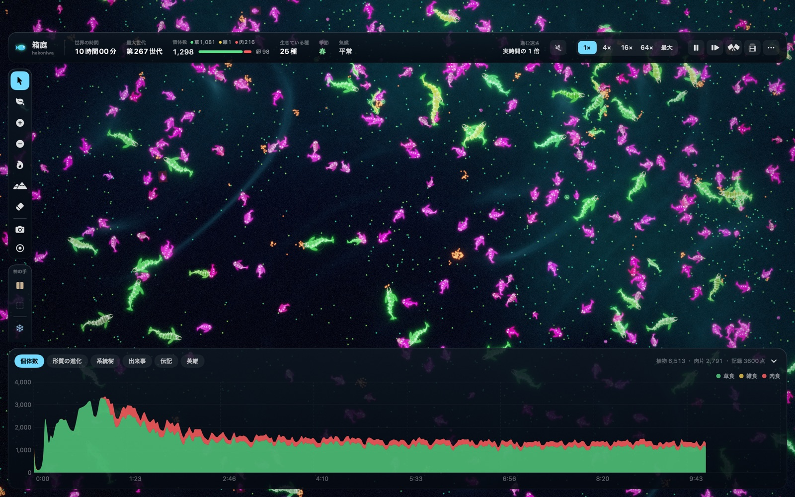
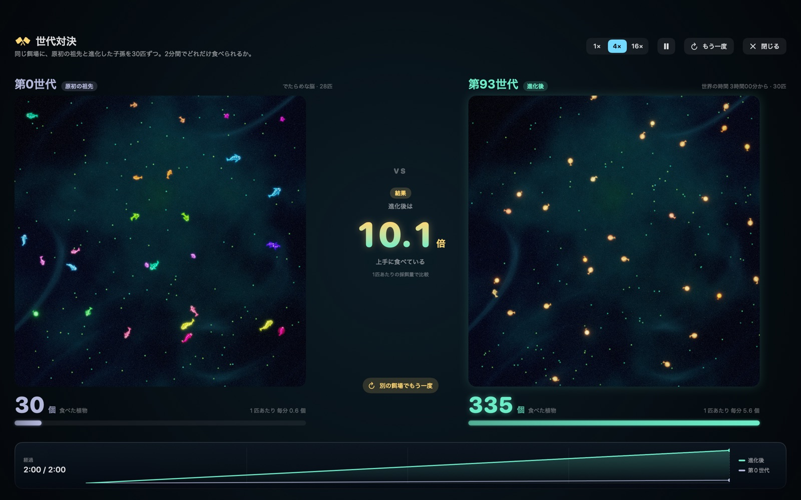
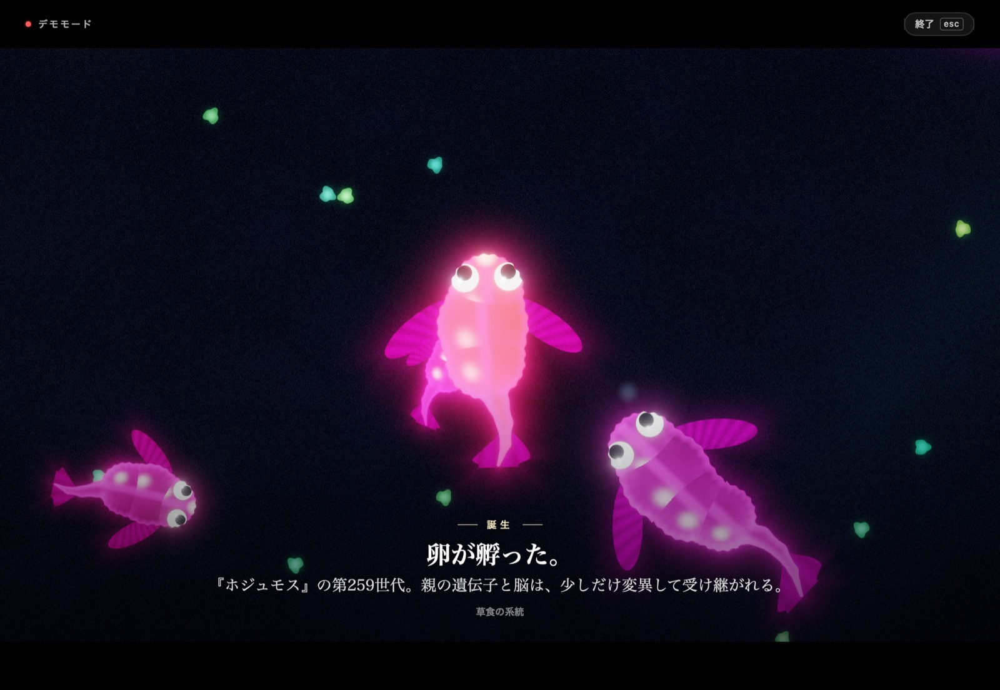
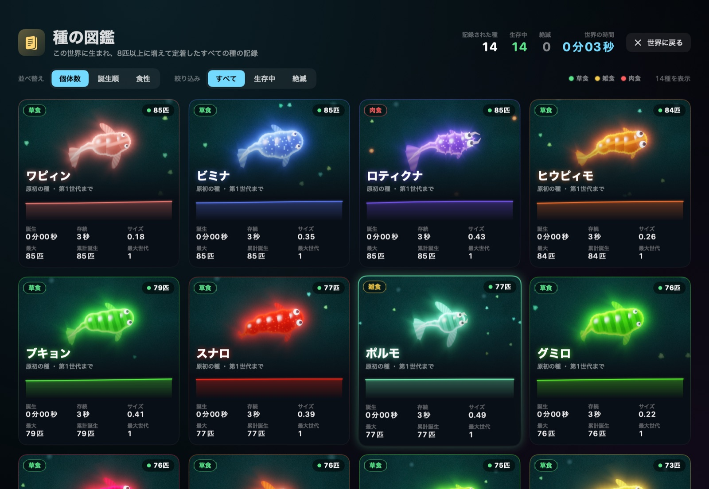
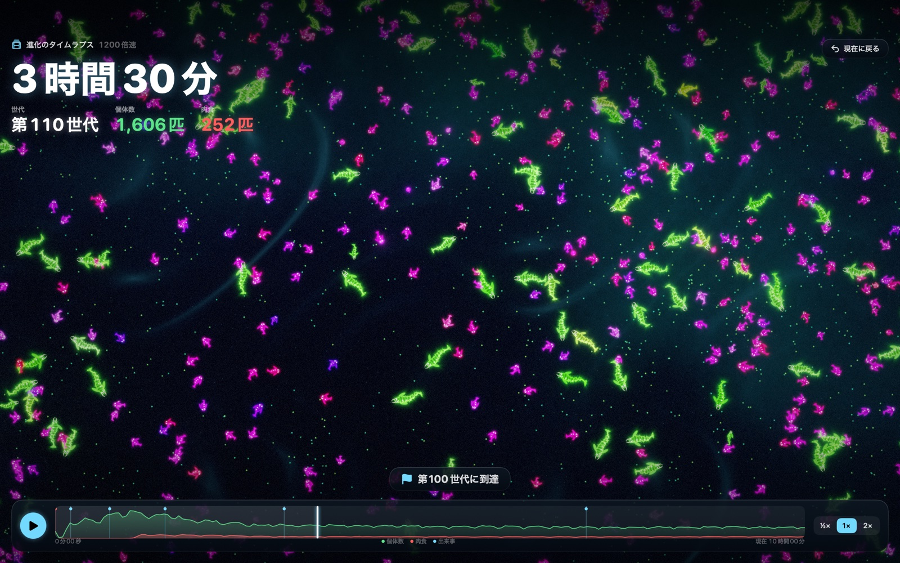
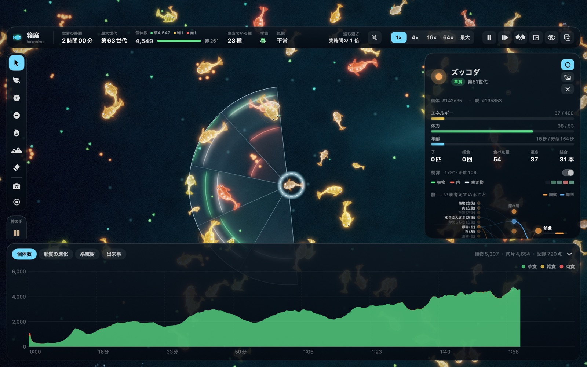
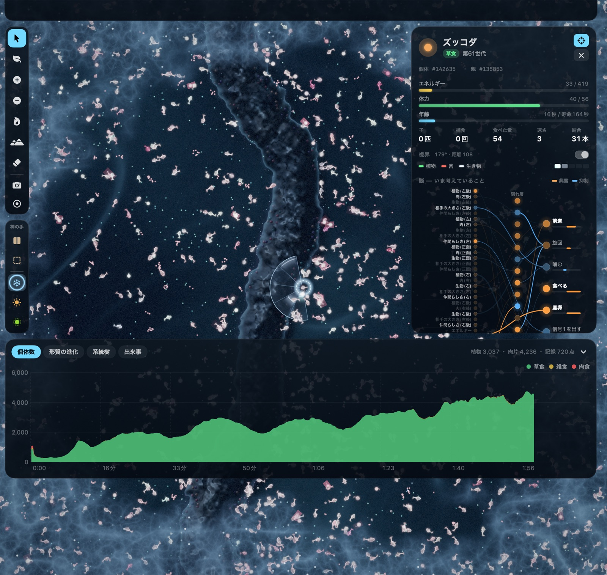
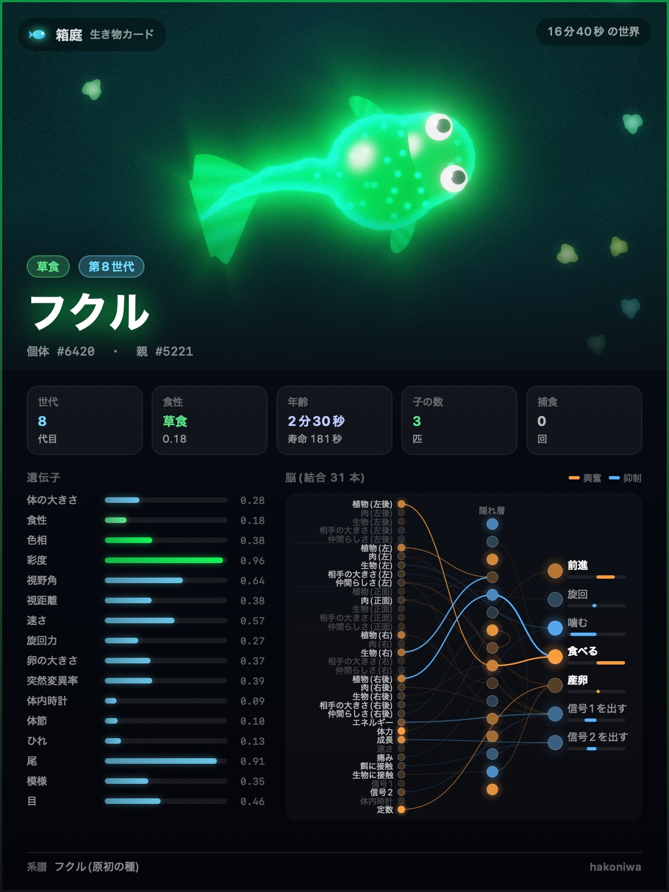

# 箱庭 (hakoniwa)



画面の中の小さな世界で、ニューラルネットの脳を持つ生き物たちが生まれ、食べ、戦い、増え、
世代を重ねて**誰も設計していない行動を自分で獲得していく**様子を眺める macOS アプリです。

「餌に向かう」「逃げる」「狩る」といった行動ルールはコードのどこにも書かれていません。
決めているのは物理・代謝・感覚器・環境だけで、行動はすべて脳の重みの進化から生まれます。
上の画面は10時間(第267世代)進化させた世界で、マゼンタの草食種と、トゲを持つ緑の肉食種が共存しています。

## 見どころ

| | |
|---|---|
|  | **世代対決** — 同じ餌場に「第0世代」と「進化後」を30匹ずつ放す。進化後は約10〜30倍の速さで餌を集める |
|  | **デモモード** — カメラが自動で狩り・誕生・群れなどの見どころを巡り、実データに基づく字幕で解説する |
|  | **種の図鑑** — これまでに現れたすべての種の肖像・歴史・系譜。個体に名前を付けて見守ることもできる |
|  | **進化のタイムラプス** — 10時間の進化を30秒で再生。シークバーで過去に戻れる |
|  | **視界と脳** — 選んだ個体が何を見て、脳のどのニューロンが発火しているかをリアルタイムで表示 |
|  | **神の手** — 壁で大陸を分断する、氷河期・温暖期・疫病を起こす、絶滅した祖先を蘇らせる |
|  | **生き物カード** — 個体の姿・遺伝子・脳を1枚の画像に書き出す |

ほかに、系統樹、種の個体数グラフ、生き物の伝記(一生の出来事を自動で記録)、英雄ランキング、
録画(mp4)、生成的な環境音があります。

## 動かし方

macOS 15 以降、Apple Silicon、Xcode(Swift 6)が必要です。

```sh
make open        # ビルドして起動(build/Hakoniwa.app)
make             # できることの一覧
```

起動すると、10時間進化させた世界(`Resources/showcase.hkw`)が読み込まれます。

### 操作

| 操作 | 内容 |
|---|---|
| ドラッグ / スクロール / ピンチ | 移動 / ズーム |
| クリック / ダブルクリック | 個体を選択 / 追尾 |
| スペース | 一時停止・再開 |
| 1〜5 | 速度(1×, 4×, 16×, 64×, 最大) |
| F / Esc | 追尾 / 選択解除 |
| ⌘D / L / ⇧⌘D / ⌘E | 世代対決 / タイムラプス / デモモード / 図鑑 |
| W / E | 壁を描く / 消す |
| ⌘R / ⇧⌘S | 録画 / スクリーンショット |

## ヘッドレス実行

画面なしで高速に進化させ、統計を確認できます(1時間で約60〜130時間分の進化)。

```sh
make evolve SEED=4 HOURS=4     # 4時間分の進化 → out/world.hkw
make assay                     # 第0世代と採餌能力を比較
make sweep SEEDS=1,2,3 HOURS=2 # 複数シードで受け入れ基準を判定
make profile                   # 性能測定
make showcase SEED=4 HOURS=10  # アプリに同梱する世界を作り直す
```

## 仕組み

- [要件定義書](docs/REQUIREMENTS.md)
- [設計書](docs/DESIGN.md)
- [進捗と作業ログ](docs/PROGRESS.md)

## テスト

```sh
make test
```
